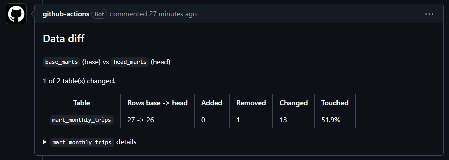
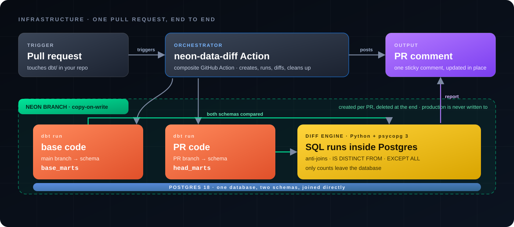
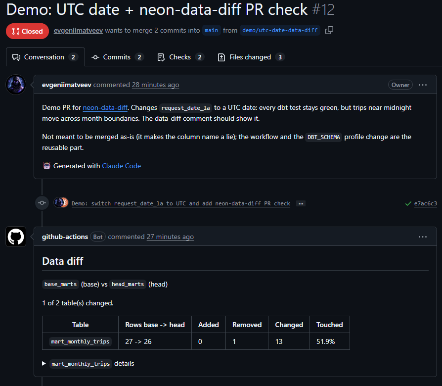

# 🔍 neon-data-diff

**Tests say your dbt data is valid. This tells you what changed.** A data diff for pull requests: it runs your dbt project twice on a throwaway Neon branch (base code vs PR code), compares the two result sets in SQL, and comments the difference on the PR.


[](https://github.com/evgeniimatveev/neon-data-diff/actions/workflows/ci.yml)
[](https://github.com/evgeniimatveev/neon-data-diff/releases)


**[Interactive demo site →](https://evgeniimatveev.github.io/neon-data-diff/)** (flip one line of code and watch the diff react) · **[Real pull request →](https://github.com/evgeniimatveev/uber-driver-analytics/pull/12)** (intentionally not merged)

---

## The problem

A passing test suite proves the data is still *valid*. It does not prove it is still *the same*. A refactor can keep every test green and quietly move your numbers.

On my own Uber driver data I changed one line in a staging model: a trip timestamp converted to a date in Los Angeles time became a date in UTC. All 20 dbt tests still passed. But trips near midnight slid into neighbouring months, 13 of 27 monthly rows changed, and one month disappeared. A diff catches it:



## Findings so far

The tool leaves its own track record here, rebuilt daily from real runs (not typed by hand).

<!-- FINDINGS:START -->
<details>
<summary><b>📈 Findings so far</b> <em>(auto-updated from real runs · click to expand)</em></summary>

#### Pull-request flow
2 pull request(s) checked in uber-driver-analytics: **1 with data changes**, 1 clean.

| Pull request | Result | What moved | Most touched table | Checked |
|---|---|---|---|---|
| [#13](https://github.com/evgeniimatveev/uber-driver-analytics/pull/13) Run neon-data-diff on every dbt PR | ✅ no differences | 2 table(s) identical | 0% | merged · 2026-11-24 |
| [#12](https://github.com/evgeniimatveev/uber-driver-analytics/pull/12) Demo: UTC date + neon-data-diff PR check | ⚠️ 1 of 2 table(s) changed | `mart_monthly_trips` 27 → 26 (+0 −1 ~13) | 51.9% | closed · 2026-11-23 |

#### Daily flow (drift watch)
Last 2 daily run(s) with the drift check: **2 without a flagged rewrite**, 0 flagged or failed. Drift issues opened so far: **0**.

| Date | Run | Drift check |
|---|---|---|
| 2026-11-25 | [schedule](https://github.com/evgeniimatveev/job-market-pulse/actions/runs/45716836028) | ✅ passed (growth only, or skipped on a first run) |
| 2026-11-24 | [schedule](https://github.com/evgeniimatveev/job-market-pulse/actions/runs/45508963710) | ✅ passed (growth only, or skipped on a first run) |

<sub>Built by <code>scripts/build_findings.py</code> from public GitHub data (the bot's sticky comments and the daily workflow's runs). Nothing here is typed by hand.</sub>

</details>
<!-- FINDINGS:END -->

## How it works



1. **A pull request touches `dbt/`**: the workflow starts (unrelated PRs cost nothing).
2. **Branch the database**: a copy-on-write clone of production, ready in under a second.
3. **`dbt run`, base code** into schema `base_*` of that branch.
4. **`dbt run`, PR code** into schema `head_*` of the *same* branch: same data, different code, so any difference is caused by the PR.
5. **Diff in SQL**: anti-joins on the keys from your dbt `unique` tests, per-column checks, counts only. No table data leaves the database.
6. **One comment**, updated in place on every push, then the branch is deleted (even if the check fails).

It reports schema changes (added, removed, retyped columns and tables) and added, removed and changed rows, with a per-column count of what changed.

<details>
<summary><b>Under the hood</b>: the flow chart, real logs and the generated SQL</summary>


The log lines below are real, copied from the Action run of the demo pull request.

**Branch the database** (about 0.6 s in this run):

```
Branch ndd/pr-45288459016-2 created successfully
```

**`dbt run`, base code** (the target branch is checked out into a separate worktree; the profile comes from the PR head so both runs share one connection setup):

```
1 of 5 OK created sql view model base_staging.stg_payments
3 of 5 OK created sql view model base_staging.stg_trips
5 of 5 OK created sql table model base_marts.mart_monthly_trips ........ [SELECT 27]
Done. PASS=5 WARN=0 ERROR=0 SKIP=0 NO-OP=0 REUSED=0 TOTAL=5
```

**`dbt run`, PR code** (same branch, other schema):

```
3 of 5 OK created sql view model head_staging.stg_trips
5 of 5 OK created sql table model head_marts.mart_monthly_trips ........ [SELECT 26]
Done. PASS=5 WARN=0 ERROR=0 SKIP=0 NO-OP=0 REUSED=0 TOTAL=5
```

**Diff, in SQL** (queries like these run inside Postgres):

```sql
-- removed rows: in base, not in head
select count(*) from base_marts.mart_monthly_trips b
left join head_marts.mart_monthly_trips h on b.month = h.month
where h.month is null;                                   -- 1

-- changed rows, plus a count per column (same pattern for each column)
select count(*) filter (where
         (b.gross_fare_usd is distinct from h.gross_fare_usd
          and not abs(b.gross_fare_usd - h.gross_fare_usd) <= 1e-09) or ...),
       count(*) filter (where ... completed_trips ...), ...
from base_marts.mart_monthly_trips b
join head_marts.mart_monthly_trips h on b.month = h.month;   -- 13
```

**The comment and clean-up.** The comment is found later by a hidden marker (`<!-- neon-data-diff -->`) so it is updated, never duplicated:

```
PR comment updated
```

The whole conversation of that pull request, including the comment the Action posted by itself:



**Keyed vs unkeyed tables.** With a key, the engine anti-joins for added and removed rows and counts changed rows per column. Without a key (or if the key is not unique) it falls back to `EXCEPT ALL` in both directions; a changed row then shows up as one removed plus one added, and the report says so.

</details>

## Quick start (GitHub Action)

```yaml
permissions:
  contents: read
  pull-requests: write          # for the sticky comment

steps:
  - uses: actions/checkout@v7
  - uses: evgeniimatveev/neon-data-diff@v0
    with:
      neon-api-key: ${{ secrets.NEON_API_KEY }}
      neon-project-id: ${{ vars.NEON_PROJECT_ID }}
```

Your dbt profile must read its connection from environment variables (`DBT_HOST`, `DBT_USER`, `DBT_PASSWORD`, `DBT_DBNAME`, `DBT_SCHEMA`). Full workflow: [`examples/neon-data-diff.yml`](examples/neon-data-diff.yml).

<details>
<summary><b>Profile contract and all Action inputs</b></summary>

The profile (taken from the PR head for both runs):

```yaml
host: "{{ env_var('DBT_HOST') }}"
user: "{{ env_var('DBT_USER') }}"
password: "{{ env_var('DBT_PASSWORD') }}"
dbname: "{{ env_var('DBT_DBNAME') }}"
schema: "{{ env_var('DBT_SCHEMA') }}"
```

With a custom schema `marts`, dbt writes `base_marts` and `head_marts`, which are the schemas compared (`schema-suffix` input).

| Input | Default | Meaning |
|---|---|---|
| `neon-api-key` / `neon-project-id` | required | Neon credentials (secret and variable) |
| `dbt-dir` | `dbt` | dbt project directory |
| `install-command` | `pip install -r requirements.txt` | run inside `dbt-dir` |
| `schema-suffix` | `marts` | which schemas to compare |
| `max-change-pct` | none | fail the check if a table has more than N% of rows touched |
| `samples` | `0` | sample changed rows per table (keep 0 on public repos) |
| `database` / `role` / `base-ref` / `python-version` / `github-token` | sensible defaults | see `action.yml` |

Pull requests from forks get no secrets and a read-only token, so the check cannot run there. For a personal or internal repo this does not matter.

</details>

## Drift watch (daily pipelines)

The same engine compares **two DuckDB files**, yesterday's database and today's. For append-only data new rows are normal, but changed or removed old rows mean the pipeline silently rewrote history. Your pipeline already downloads the database before it runs, so copy that file first and diff after:

```bash
neon-data-diff \
  --duckdb-base yesterday.duckdb --duckdb-head today.duckdb \
  --key events=event_id --key daily_stats=day,city \
  --base-label yesterday --head-label today --title "Data drift" \
  --max-rewrite-pct 0        # growth is fine, any rewritten row fails
```

A full workflow that does this and opens an issue when history changes: [`examples/drift-watch.yml`](examples/drift-watch.yml). Install with `pip install "neon-data-diff[duckdb] @ git+https://github.com/evgeniimatveev/neon-data-diff"`.

<details>
<summary><b>Example drift report</b></summary>

From a simulation on the real schema of a daily job-market pipeline: 110 appended rows (normal) and one silently edited historical row (flagged).

```
## Data drift
`yesterday` (base) vs `today` (head)

**History rewritten** (removed + changed rows above 0% of base): `job_market_history` 1 row(s)

| Table | Rows base -> head | Added | Removed | Changed | Touched |
| `job_market_history` | 9,240 -> 9,350 | 110 | 0 | 1 | 1.2% |
```

</details>

## Limitations

- Postgres mode: both schemas must live in the same database. DuckDB mode: two files, attached read-only.
- Non-deterministic models (e.g. `current_timestamp`) always show as changed.
- The Action is verified end to end on one project (the demo above), not yet on a wide range of dbt setups.
- Similar tools exist (Datafold data-diff, dbt-audit-helper, Recce). This one is a small, Neon-branch-native alternative with no extra infrastructure.

---

## More details

<details>
<summary><b>Design decisions</b></summary>

- **One branch, two schemas.** Separate branches have separate endpoints and cannot be joined, so base and head are built into two schemas of one branch and compared with plain SQL joins.
- **Comparison runs in the database.** No table data is pulled into Python or into logs. Only counts come back, which is also what makes it safe on private data.
- **Keys come from your tests.** A `unique` (or `dbt_utils.unique_combination_of_columns`) test is already a statement of what identifies a row, so the manifest is the source of truth.
- **`NULL` to value is a change.** The check uses `IS DISTINCT FROM`, not `<>`, which would silently skip `NULL`s.
- **Float noise is not a change.** Numeric columns use a tolerance (default `1e-9`) so `0.1 + 0.2` vs `0.3` is not reported.
- **Opt-in for anything that could leak or mislead.** Sample rows are off by default (public repos). `sum()` shifts are off by default (summing averages or percentages is meaningless).
- **Base and head use the same profile**, taken from the PR head, so a change to the connection setup cannot make base and head differ.
- **`dbt run`, not `dbt build`.** The Action compares data, it does not replace your test job.

</details>

<details>
<summary><b>CLI reference</b></summary>

```bash
pip install git+https://github.com/evgeniimatveev/neon-data-diff   # not on PyPI

export DATABASE_URL=postgresql://...
neon-data-diff \
  --base-schema base_marts --head-schema head_marts \
  --manifest dbt/target/manifest.json \
  --markdown diff.md
```

| Option | Meaning |
|---|---|
| `--manifest` | dbt `manifest.json`, source of keys |
| `--key TABLE=COL[,COL]` | explicit key, repeatable (composite keys supported) |
| `--tolerance` | numeric tolerance, default `1e-9` |
| `--samples N` | include up to N changed rows per table (off by default) |
| `--sums` | also report `sum()` shifts (off by default) |
| `--only TABLE` | limit to some tables |
| `--fail-on-change` | exit 1 if anything differs |
| `--max-change-pct N` | exit 1 if added+removed+changed rows exceed N% of base rows in any table |
| `--max-rewrite-pct N` | exit 1 if removed+changed rows exceed N% of base rows (growth by added rows is allowed; 0 = any rewrite fails) |
| `--duckdb-base` / `--duckdb-head` / `--duckdb-schema` | DuckDB mode: compare two database files (default schema `main`) |
| `--base-label` / `--head-label` / `--title` | names and heading used in the report |
| `--post-comment` | create or update the sticky PR comment (`GITHUB_TOKEN`, `GITHUB_REPOSITORY`, PR from `--pr` or `GITHUB_REF`) |

</details>

<details>
<summary><b>Infrastructure and CI/CD</b></summary>

| Layer | Tool | Role |
|---|---|---|
| Database | Neon (Postgres 18) | copy-on-write branch per PR, deleted afterwards |
| Transform | dbt-core 1.12 + dbt-postgres | builds the models twice, base and head |
| Diff engine | Python + psycopg 3 / DuckDB | generates the comparison SQL, runs it in the database (Postgres schemas or two DuckDB files) |
| Delivery | GitHub composite Action | create branch, run dbt, diff, comment, cleanup |
| Comment | GitHub REST API | one comment found by a hidden marker, updated in place |

| Workflow | Trigger | What it runs | Status |
|---|---|---|---|
| [CI](.github/workflows/ci.yml) | push to `main`, every PR | pytest on Python 3.10 / 3.12 / 3.13 x Postgres 16 / 17 (6 jobs, DuckDB tests included), plus a check that `action.yml` parses | [](https://github.com/evgeniimatveev/neon-data-diff/actions/workflows/ci.yml) |
| [Findings](.github/workflows/findings.yml) | daily + manual | rebuilds the "Findings so far" block above from public GitHub data, commits only when it changed | [](https://github.com/evgeniimatveev/neon-data-diff/actions/workflows/findings.yml) |

44 tests: the diff engine against a real Postgres (added / removed / changed rows, tolerance, NULLs, schema changes, unkeyed fallback, composite keys), the same engine on two DuckDB files (growth vs rewritten history), the CLI (exit codes, thresholds, missing config), the renderer, the manifest key reader, the sticky-comment logic against a fake GitHub API, and the findings-block builder.

</details>

<details>
<summary><b>FAQ</b></summary>

**Does it touch my production database?** No. Production is only the source the branch is cloned from. Every write (both dbt runs) happens on the clone, which is deleted at the end.

**What does it cost?** Storage only for data that changes on the branch, plus the compute time of a run that lasts about a minute. The workflow itself is two `dbt run`s plus a few queries. Check your own Neon plan for exact limits.

**Can it run on pull requests from forks?** No: forks get no secrets and a read-only token. For a personal or internal repo this does not matter.

**Why not just compare `dbt test` results?** Tests assert rules you already thought of. A diff shows what you did not think of.

**Is it Neon-only?** No. The diff engine works on any Postgres with two schemas, and on two DuckDB files (drift watch). The pull-request Action is built around Neon branches.

</details>

<details>
<summary><b>Development</b></summary>

```bash
# needs a throwaway Postgres; the tests create and drop the schemas "base" and "head"
TEST_DATABASE_URL=postgresql://user@localhost:5432/scratch uv run --with-editable ".[dev]" pytest

# rebuild the demo site (docs/index.html) after editing docs/template.html or docs/data.json
python docs/build.py
```

Do not point `TEST_DATABASE_URL` at a database you care about.

</details>

---

*Built by Evgenii Matveev · MIT licensed*
