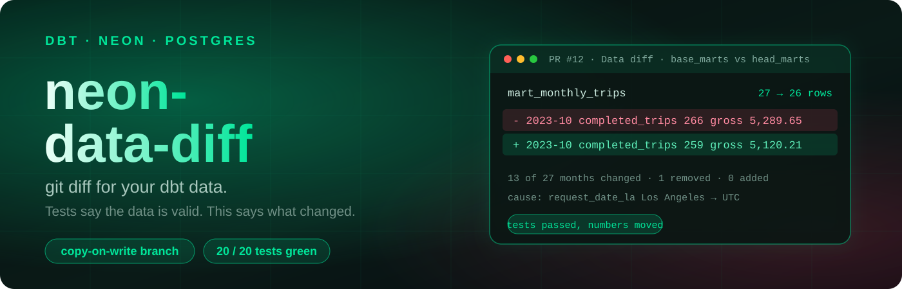
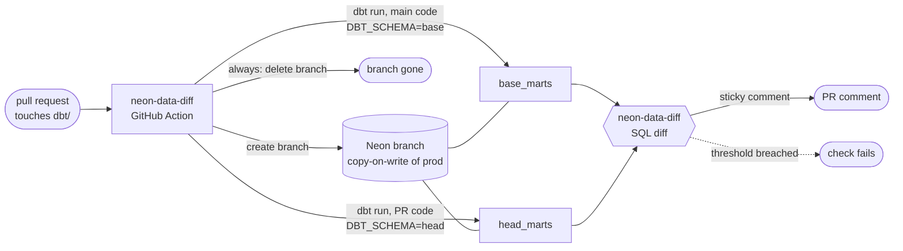

# 🔍 neon-data-diff

**Tests say your dbt data is valid. This tells you what changed.** A data diff for pull requests: it runs your dbt project twice on a throwaway Neon branch (base code vs PR code), compares the two result sets in SQL, and comments the difference on the PR.


[](https://github.com/evgeniimatveev/neon-data-diff/actions/workflows/ci.yml)
[](https://github.com/evgeniimatveev/neon-data-diff/releases)




**[Live demo → uber-driver-analytics PR #12](https://github.com/evgeniimatveev/uber-driver-analytics/pull/12)** (one staging column switched from Los Angeles time to UTC; all 20 dbt tests pass; the bot comment shows what moved. Intentionally not merged.)

---

## The problem

A passing test suite proves the data is still *valid*. It does not prove the data is still *the same*. A refactor can keep every test green and quietly move your numbers.

On my own Uber driver data, changing one line in a staging model (`request_at` to a date in Los Angeles time vs UTC) keeps all 20 tests passing. The diff catches it: trips near midnight slid into neighbouring months, 13 of 27 monthly rows changed, and one month disappeared.

## What a pull request gets

One comment, updated on every push (never duplicated):

| Table | Rows base -> head | Added | Removed | Changed | Touched |
|---|---|---|---|---|---|
| `mart_monthly_trips` | 27 -> 26 | 0 | 1 | 13 | 51.9% |

- `completed_trips`: 11 row(s) changed
- `gross_fare_usd`: 13 row(s) changed
- `avg_fare_usd`: 11 row(s) changed
- `surged_pct`: 9 row(s) changed

Every number comes from SQL running inside the database, so no table data leaves it. Only counts come back (sample rows are opt-in, because in a public repo a comment would publish your data).

## How it works



Neon branches are copy-on-write, so branching production takes seconds and no extra storage up front. Both dbt runs share **one** branch (two schemas) because separate branches have separate endpoints and cannot be joined. Production is never written to.

## Quick start (GitHub Action)

```yaml
permissions:
  contents: read
  pull-requests: write          # for the sticky comment

steps:
  - uses: actions/checkout@v7
  - uses: evgeniimatveev/neon-data-diff@v0
    with:
      neon-api-key: ${{ secrets.NEON_API_KEY }}
      neon-project-id: ${{ vars.NEON_PROJECT_ID }}
```

Full workflow: [`examples/neon-data-diff.yml`](examples/neon-data-diff.yml).

**Contract with your dbt project.** The profile (taken from the PR head for both runs) must read its connection from environment variables:

```yaml
host: "{{ env_var('DBT_HOST') }}"
user: "{{ env_var('DBT_USER') }}"
password: "{{ env_var('DBT_PASSWORD') }}"
dbname: "{{ env_var('DBT_DBNAME') }}"
schema: "{{ env_var('DBT_SCHEMA') }}"
```

With a custom schema `marts`, dbt writes `base_marts` and `head_marts`, which are the schemas compared (`schema-suffix` input).

| Input | Default | Meaning |
|---|---|---|
| `neon-api-key` / `neon-project-id` | required | Neon credentials (secret and variable) |
| `dbt-dir` | `dbt` | dbt project directory |
| `install-command` | `pip install -r requirements.txt` | run inside `dbt-dir` |
| `schema-suffix` | `marts` | which schemas to compare |
| `max-change-pct` | none | fail the check if a table has more than N% of rows touched |
| `samples` | `0` | sample changed rows per table (keep 0 on public repos) |
| `database` / `role` / `base-ref` / `python-version` / `github-token` | sensible defaults | see `action.yml` |

Pull requests from forks get no secrets and a read-only token, so the check cannot run there. For a personal or internal repo this does not matter.

## What it compares

- **Schema:** added, removed and retyped columns; added and removed tables.
- **Keyed tables:** anti-joins on the key for added and removed rows, and a per-column count of changed rows. `NULL` to value counts as a change. Keys come from dbt `unique` and `dbt_utils.unique_combination_of_columns` tests in the manifest.
- **Unkeyed tables** (no key, or key not unique): falls back to `EXCEPT ALL` in both directions. A changed row then shows up as one removed plus one added, and the report says so.
- **Float noise:** numeric columns use a tolerance (default `1e-9`).

## CLI

```bash
pip install git+https://github.com/evgeniimatveev/neon-data-diff   # not on PyPI

export DATABASE_URL=postgresql://...
neon-data-diff \
  --base-schema base_marts --head-schema head_marts \
  --manifest dbt/target/manifest.json \
  --markdown diff.md
```

| Option | Meaning |
|---|---|
| `--manifest` | dbt `manifest.json`, source of keys |
| `--key TABLE=COL[,COL]` | explicit key, repeatable (composite keys supported) |
| `--tolerance` | numeric tolerance, default `1e-9` |
| `--samples N` | include up to N changed rows per table (off by default) |
| `--sums` | also report `sum()` shifts (meaningless for averages and percentages, so opt-in) |
| `--only TABLE` | limit to some tables |
| `--fail-on-change` | exit 1 if anything differs |
| `--max-change-pct N` | exit 1 if added+removed+changed rows exceed N% of base rows in any table |
| `--post-comment` | create or update the sticky PR comment (`GITHUB_TOKEN`, `GITHUB_REPOSITORY`, PR from `--pr` or `GITHUB_REF`) |

## Infrastructure

| Layer | Tool | Role |
|---|---|---|
| Database | Neon (Postgres 18) | copy-on-write branch per PR, deleted afterwards |
| Transform | dbt-core 1.12 + dbt-postgres | builds the models twice, base and head |
| Diff engine | Python + psycopg 3 | generates the comparison SQL, runs it in the database |
| Delivery | GitHub composite Action | create branch, run dbt, diff, comment, cleanup |
| Comment | GitHub REST API | one comment found by a hidden marker, updated in place |

### CI/CD

| Workflow | Trigger | What it runs | Status |
|---|---|---|---|
| [CI](.github/workflows/ci.yml) | push to `main`, every PR | pytest on Python 3.10 / 3.12 / 3.13 x Postgres 16 / 17 (6 jobs), plus a check that `action.yml` parses | [](https://github.com/evgeniimatveev/neon-data-diff/actions/workflows/ci.yml) |

25 tests: the diff engine against a real Postgres (added / removed / changed rows, tolerance, NULLs, schema changes, unkeyed fallback, composite keys), the CLI (exit codes, thresholds, missing config), the renderer, the manifest key reader, and the sticky-comment logic against a fake GitHub API.

## Limitations

- Both schemas must live in the same database.
- Non-deterministic models (e.g. `current_timestamp`) always show as changed.
- `dbt run` is used, not `build`: run your tests in your normal CI job.
- The Action itself is verified end to end on one project (the demo above), not yet on a wide range of dbt setups.
- Similar tools exist (Datafold data-diff, dbt-audit-helper, Recce). This one is a small, Neon-branch-native alternative with no extra infrastructure.

## Development

```bash
# needs a throwaway Postgres; the tests create and drop the schemas "base" and "head"
TEST_DATABASE_URL=postgresql://user@localhost:5432/scratch uv run --with-editable ".[dev]" pytest
```

Do not point `TEST_DATABASE_URL` at a database you care about.

---

*Built by Evgenii Matveev · MIT licensed*
